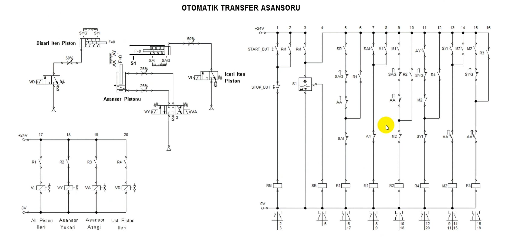
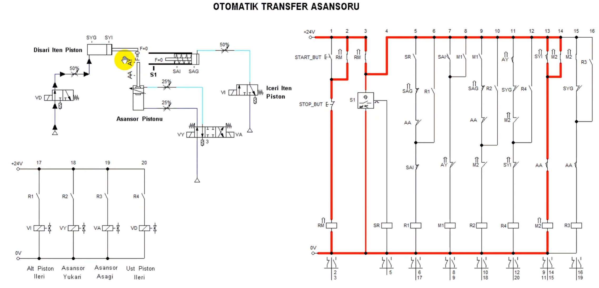
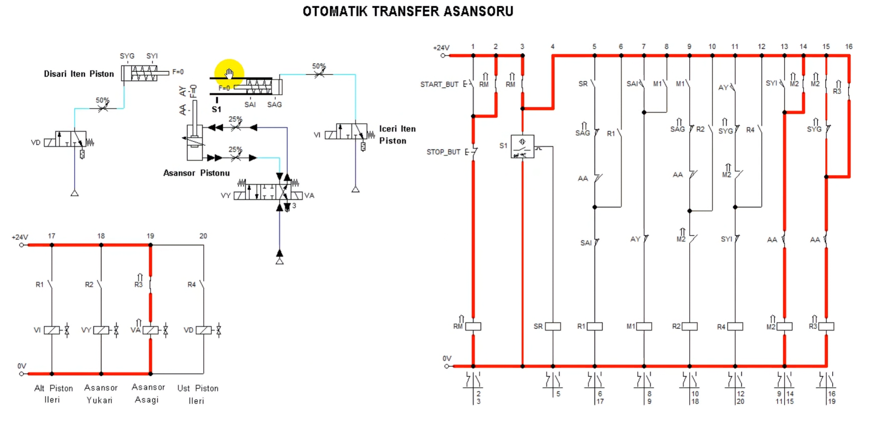
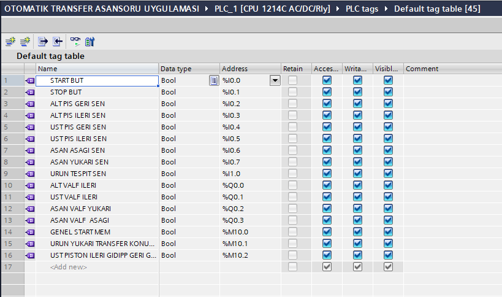
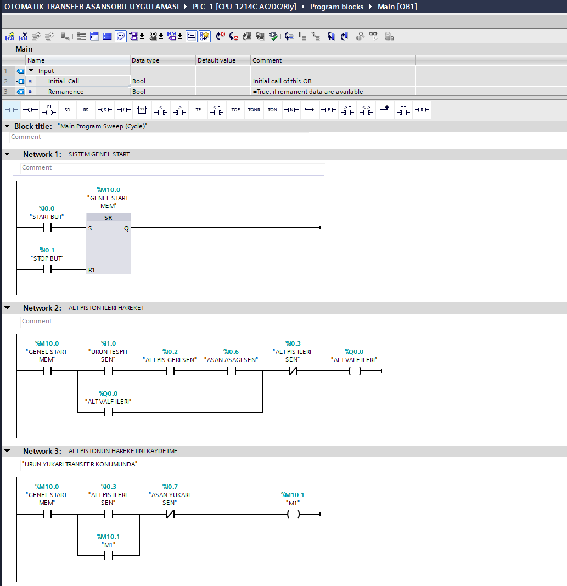
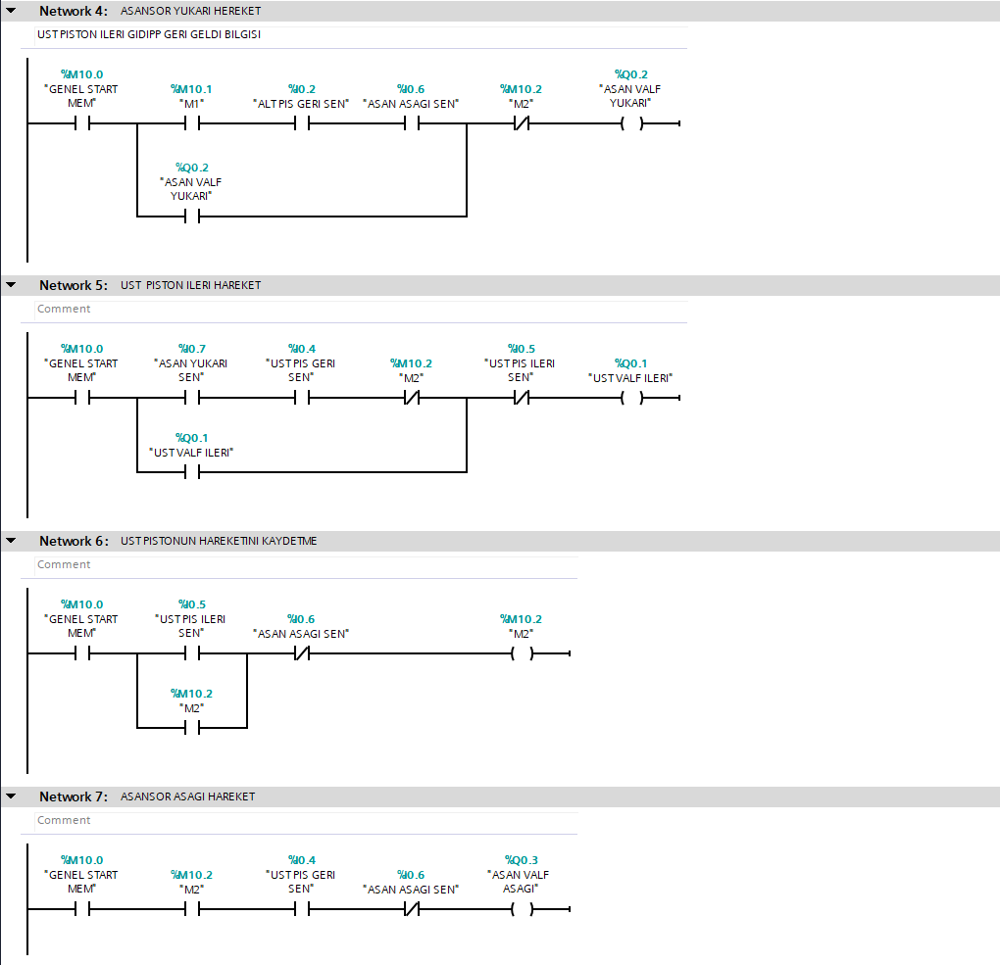
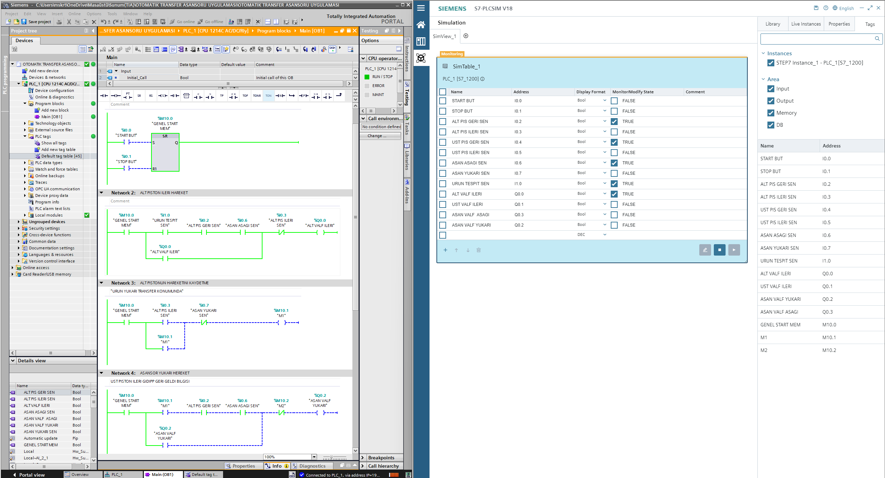
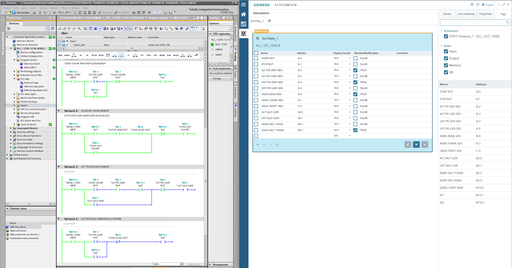

# Otomatik Transfer Asansörü | Siemens S7-1200 PLC

**Siemens S7-1200 PLC, TIA Portal V18, Ladder, S7-PLCSIM ve FluidSIM ile Otomatik Elektropnömatik Transfer Asansörü Kontrolü**

## 📌 Proje Hakkında

Bu projede, ürünlerin pnömatik pistonlar aracılığıyla farklı konumlara taşınmasını sağlayan otomatik bir transfer asansörü sistemi tasarlanmış ve PLC ile kontrol edilmiştir.

Sistem ilk olarak FluidSIM ortamında klasik röleli kumanda mantığıyla modellenmiş, ardından Siemens TIA Portal V18 üzerinde Ladder (LAD) programlama dili kullanılarak PLC kontrol algoritması oluşturulmuştur.

PLC programının çalışma durumları S7-PLCSIM üzerinden izlenerek giriş/çıkış sinyalleri ve hareket sıralaması test edilmiştir.

## 🛠️ Kullanılan Teknolojiler

- **PLC:** Siemens SIMATIC S7-1200 (CPU 1214C AC/DC/Rly)
- **Programlama Yazılımı:** Siemens TIA Portal V18
- **Programlama Dili:** Ladder Diagram (LAD)
- **PLC Simülasyonu:** Siemens S7-PLCSIM V18
- **Elektropnömatik Simülasyon:** FluidSIM
- **Kontrol Elemanları:** Sensörler, röleler, solenoid valfler ve pnömatik silindirler

## ⚙️ Sistemin Çalışma Prensibi

Otomatik transfer asansörü, ürün algılama sensöründen gelen bilgi doğrultusunda başlatılan sıralı bir elektropnömatik hareket sistemi olarak tasarlanmıştır.

**1. Sistemin Başlatılması**

START butonuna basıldığında PLC içerisindeki genel çalışma hafızası aktif olur. STOP butonu ile sistemin çalışma izni sıfırlanabilir.

**2. Alt Pistonun İleri Hareketi**

Ürün tespit edildiğinde ve gerekli başlangıç konumları sağlandığında alt piston ileri hareket ederek ürünü transfer konumuna taşır.

**3. Asansörün Yukarı Hareketi**

Alt pistonun ileri konuma ulaştığı sensörle algılandıktan sonra asansörün yukarı hareketini sağlayan solenoid valf kontrol edilir.

**4. Üst Pistonun İleri Hareketi**

Asansör üst konuma ulaştığında üst piston ileri hareket ederek ürünün transfer işlemini gerçekleştirir.

**5. Asansörün Aşağı Hareketi**

Üst piston hareketine ait konum bilgileri değerlendirilerek asansörün aşağı hareketi kontrol edilir.

**6. Hareketlerin Kontrolü**

PLC programında sensör geri bildirimleri, yardımcı hafıza bitleri ve kilitleme koşulları kullanılarak hareketlerin belirlenen sıraya uygun şekilde gerçekleşmesi amaçlanmıştır.

## 🔌 PLC Giriş ve Çıkış Adresleri

### Dijital Girişler

| Adres | Açıklama |
|---|---|
| I0.0 | START butonu |
| I0.1 | STOP butonu |
| I0.2 | Alt piston geri sensörü |
| I0.3 | Alt piston ileri sensörü |
| I0.4 | Üst piston geri sensörü |
| I0.5 | Üst piston ileri sensörü |
| I0.6 | Asansör aşağı sensörü |
| I0.7 | Asansör yukarı sensörü |
| I1.0 | Ürün tespit sensörü |

### Dijital Çıkışlar

| Adres | Açıklama |
|---|---|
| Q0.0 | Alt piston ileri valfi |
| Q0.1 | Üst piston ileri valfi |
| Q0.2 | Asansör yukarı valfi |
| Q0.3 | Asansör aşağı valfi |

### PLC Hafıza Bitleri

| Adres | Açıklama |
|---|---|
| M10.0 | Genel START hafızası |
| M10.1 | M1 – Transfer konumu hareket hafızası |
| M10.2 | M2 – Üst piston hareket hafızası |

## 🧠 PLC Programlama Yapısı

PLC kontrol algoritması, TIA Portal ortamında OB1 ana program bloğu içerisinde Ladder diliyle hazırlanmıştır.

Program toplam 7 Network üzerinden oluşturulmuştur.

| Network | Görevi |
|---|---|
| Network 1 | Sistem genel START kontrolü |
| Network 2 | Alt piston ileri hareketi |
| Network 3 | Alt piston hareketinin hafızaya alınması |
| Network 4 | Asansör yukarı hareketi |
| Network 5 | Üst piston ileri hareketi |
| Network 6 | Üst piston hareketinin hafızaya alınması |
| Network 7 | Asansör aşağı hareketi |

Programda mühürleme, yardımcı hafıza bitleri, sensör kontrollü hareket ve kilitleme mantıkları kullanılmıştır.

## 📷 Proje Görselleri

### 1. FluidSIM – Klasik Kumanda ve Elektropnömatik Devre

### 2. FluidSIM – Sistemin İlk Hareketi

### 3. FluidSIM – Üst Piston İleri Hareketi

### 4. FluidSIM – Asansör Aşağı Hareketi

### 5. PLC Giriş ve Çıkış Adresleri

### 6. TIA Portal – Ladder Programı Bölüm 1

### 7. TIA Portal – Ladder Programı Bölüm 2

### 8. S7-PLCSIM – Alt Piston Hareket Testi

### 9. S7-PLCSIM – Asansör Yukarı Hareket Testi

## 📂 Proje Dosyası

Projenin TIA Portal V18 ile oluşturulan arşiv dosyası bu depoda bulunmaktadır.

**Dosya:** `OTOMATIK TRANSFER ASANSORU UYGULAMASI.zap18`

Bu dosya TIA Portal V18 üzerinde geri yüklenerek PLC programı, donanım yapılandırması ve ilgili proje bileşenleri incelenebilir.

## 🎯 Projede Uygulanan Mühendislik Konuları

- Siemens S7-1200 PLC programlama
- Ladder (LAD) ile kontrol algoritması geliştirme
- Klasik kumanda devrelerinin PLC mantığına aktarılması
- Elektropnömatik sistemlerin modellenmesi
- Sensör ve solenoid valf kontrolü
- PLC dijital giriş/çıkış adresleme
- Yardımcı hafıza bitleri ve mühürleme mantığı
- Sıralı hareket kontrolü
- S7-PLCSIM ile program izleme ve simülasyon testleri

## 👨‍💻 Geliştirici

**Mustafa Şahin**  
Elektrik-Elektronik Mühendisi

**GitHub:** [msahin-engineering](https://github.com/msahin-engineering)

Bu proje, PLC programlama, endüstriyel otomasyon ve elektropnömatik kontrol sistemleri alanlarında uygulamalı mühendislik becerilerini geliştirmek amacıyla hazırlanmıştır.
